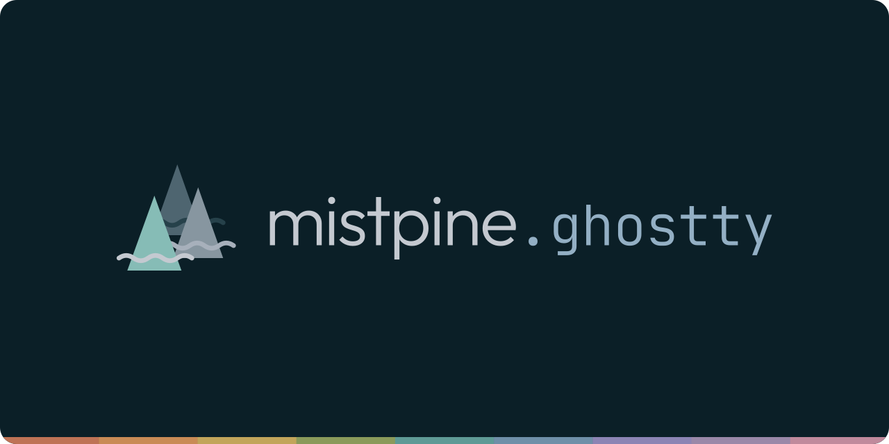
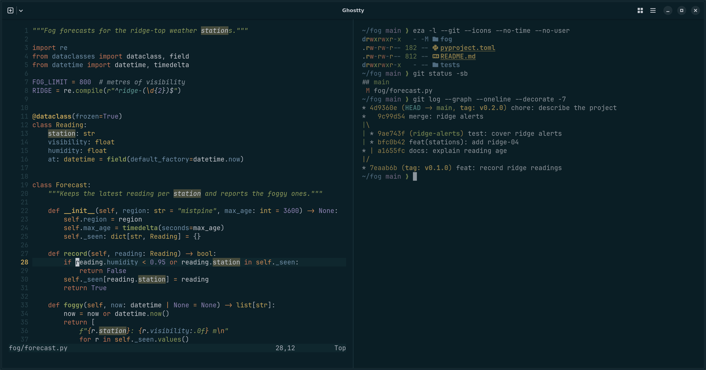
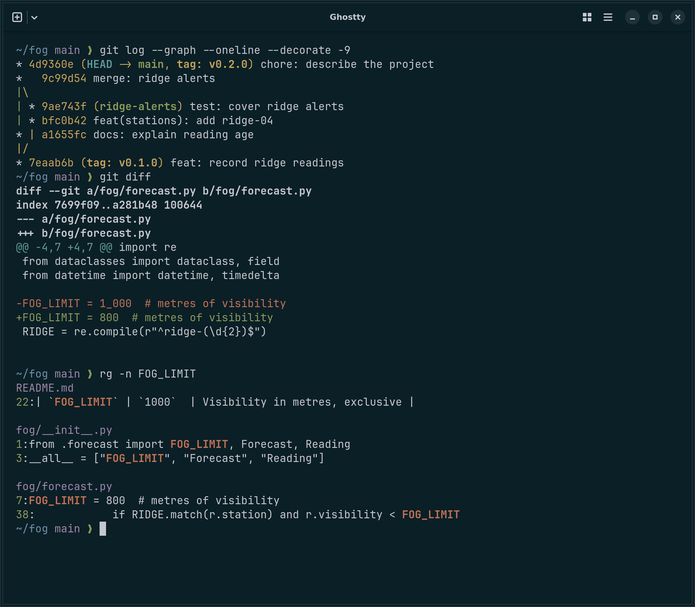
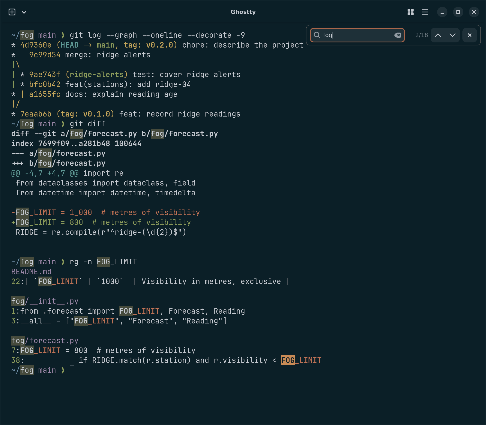
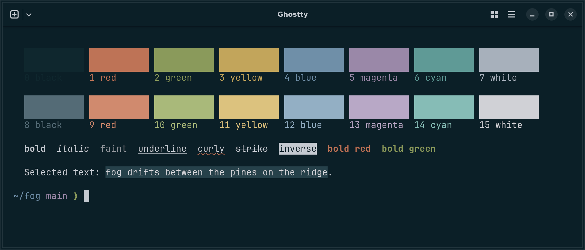

<p align="center">
  
</p>

<p align="center">
  
</p>

**mistpine** for [Ghostty](https://ghostty.org): cool, misty grays over a deep
blue-green night, with muted, earthy accents. It is the Ghostty port of
[mistpine](https://github.com/mistpine/mistpine) and follows the
[mistpine spec](https://github.com/mistpine/mistpine/blob/main/docs/spec.md):
every color is the spec's, generated from its palette file and checked against
Ghostty itself.

- The 16 ANSI colors, background, foreground, cursor and selection from the
  spec's terminal table. ANSI 0 is a raised surface, not the background, so
  black-on-default output stays visible.
- Search highlights in the spec's search colors: matches on a yellow blend,
  the selected match in orange (Ghostty 1.3+).
- Split dividers in the border color; unfocused splits recede toward the
  darkest surface.
- Colors only: fonts, opacity, padding and keybindings stay yours.

The screenshots are the real app, Ghostty 1.4 on Linux, and the render fails if a
single theme color comes out different from the spec.

## Install

Requires Ghostty 1.3 or later (`ghostty +version`).

```sh
mkdir -p ~/.config/ghostty/themes
curl -fsSL -o ~/.config/ghostty/themes/mistpine \
  https://raw.githubusercontent.com/mistpine/mistpine.ghostty/main/themes/mistpine
```

Then set the theme in your Ghostty config (`~/.config/ghostty/config`, or
open it with `ctrl+,` / `cmd+,`) and reload it (`ctrl+shift+,` /
`cmd+shift+,`):

```ini
theme = mistpine
```

The same path works on macOS. To follow updates with `git pull` instead,
clone this repository and point `theme` at the file:
`theme = /path/to/mistpine.ghostty/themes/mistpine`.

mistpine is dark only. To switch with the system appearance, pair it with a
light theme: `theme = dark:mistpine,light:<a light theme>`.

On Ghostty 1.2 or older, the four `search-*` lines are unknown keys: upgrade,
or delete them from the file.

## Customize

Anything in your config overrides the theme. Options mistpine leaves to you:

```ini
# Derive the 256-color palette (16-255) from mistpine's 16 colors, so
# 256-color apps match the theme too (Ghostty 1.3+).
palette-generate = true

# Draw the GTK titlebar and tabs in the terminal colors.
window-theme = ghostty

# Dim unfocused splits more (default 0.7; 1 turns dimming off).
unfocused-split-opacity = 0.6

# Bold text in the bright colors. The spec keeps bold in its own color.
bold-color = bright
```

## What the theme sets

| Ghostty                                                   | mistpine                                    |
| --------------------------------------------------------- | ------------------------------------------- |
| `background`, `foreground`                                | `bg1` `#0b1f27`, `fg3` `#c4c9d0`            |
| `cursor-color`, `cursor-text`                             | `fg3`, `bg1`                                |
| `selection-background`, `selection-foreground`            | `bg4` `#26414a`, `#d0d1d6`                  |
| `palette = 0..15`                                         | the spec's terminal table                   |
| `search-background`, `search-foreground`                  | `searchBg` `#464b3c`, `fg3`                 |
| `search-selected-background`, `search-selected-foreground` | `curSearchBg` `#c98b56` (orange), `bg1`     |
| `split-divider-color`                                     | `border` `#26414a`                          |
| `unfocused-split-fill`                                    | `panelBg` `#071921`                         |

## Screenshots

| | |
| :-: | :-: |
|  |  |



## Development

Requires Node 24+ and pnpm (`corepack enable`).

```sh
pnpm install
pnpm generate  # themes/mistpine from the mistpine spec
pnpm check     # fail if themes/mistpine is out of date
pnpm verify    # Ghostty validates the theme and resolves every color to the spec
pnpm render    # README screenshots from real Ghostty under Xvfb
pnpm banner    # assets/banner.svg and the social preview (Chromium)
pnpm lint && pnpm typecheck
```

Never edit `themes/mistpine` by hand. `scripts/generate.ts` maps each Ghostty
key to a spec token and reads the colors from
[`palette/mistpine.json`](https://github.com/mistpine/mistpine/blob/main/palette/mistpine.json)
(from `$MISTPINE_DIR`, `../mistpine` or GitHub), so color changes happen
upstream. It also recomputes the spec's blends and requires 4.5:1 for text on
the theme's backgrounds.

`pnpm verify` needs Ghostty 1.3+ (`$GHOSTTY` or `ghostty` on `PATH`). CI runs
it against the Ghostty snap. `pnpm render` also needs Xvfb, xdotool,
ImageMagick, git, ripgrep, eza and Neovim with the Python Tree-sitter parser,
plus a checkout of [mistpine.nvim](https://github.com/mistpine/mistpine.nvim)
(`$MISTPINE_NVIM`, default `../mistpine.nvim`). It runs Ghostty with software
OpenGL on a sample repository in `scripts/render`, installs the theme by
name in an isolated config and checks the screenshots' pixels against the
theme.

## Credits

- Designed in [themes.utimura.io](https://themes.utimura.io).
- [Outfit](https://github.com/Outfitio/Outfit-Fonts) and
  [JetBrains Mono](https://github.com/JetBrains/JetBrainsMono) in the banner.
  The screenshots use JetBrains Mono as built into Ghostty.

## License

[MIT](LICENSE). Outfit and JetBrains Mono (in `scripts/fonts`, for the banner) are under the
SIL Open Font License 1.1.
